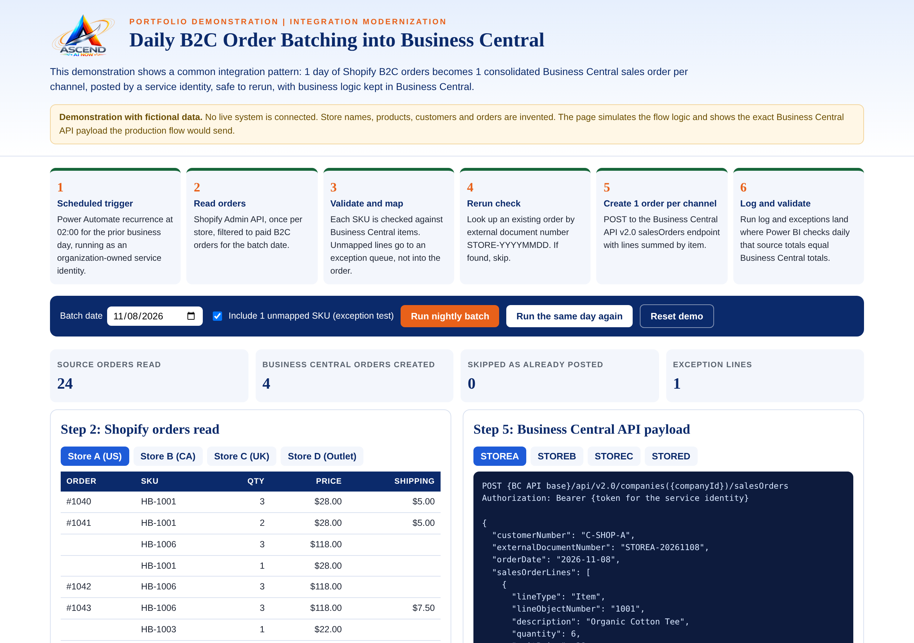

# Integration Modernization Portfolio

**Dr. Alexis S. Smith** | Integration and Data Platform Architect | Founder & Chief Executive Officer, [Ascend AI NOW, LLC](https://www.ascendainow.com)

This repository shows how I take over an integration estate that was built around one person and rebuild it into something the organization owns, documents and can run on its own. It covers the Microsoft stack I work in: Power Automate, Microsoft Dynamics 365 Business Central, Azure, Microsoft Fabric and Power BI, with Shopify and Amazon as commerce channels.

**[▶ Open the live demo](https://ascendainow.github.io/integration-modernization-portfolio/demo/)** · **[📄 View the sample Phase 1 assessment](sample-assessment/)** · **[🧭 How Phase 1 works in 10 hours](#phase-1-in-10-hours)**

## Delivery record

30 years in technology · 19 years at director level or higher · 37-person architecture organization led · about 10 system go-lives led

Production work behind this portfolio. Client names are withheld here and provided to evaluators on request.

| Engagement | What I delivered | Stack |
|---|---|---|
| Inherited platform transition (current), regional real estate development firm | Platform Owner of an inventory analytics platform built and run by a departing outside consultant. Assessed it against its documentation and delivered a transition plan with deliverables and milestones to the Chief Financial Officer. | Azure SQL Database with stored procedures for validated bulk updates, 2 Power Apps canvas apps including a Data Trust Center, Power BI semantic model, cloud ERP (Acumatica) data into Power BI, Smartsheet reporting |
| Commerce channel integrations | Shopify commerce work for an international service organization, and an Amazon order integration for an e-commerce retailer, moving marketplace orders into the business's operating systems | Shopify, Amazon, order integration |
| Inherited tenant governance (since August 2026), national education foundation | Inherited the Microsoft 365 tenant, Power Automate workflows and an unfinished backlog (multi-factor authentication rollout, security and configuration audit, disaster recovery plan). Replaced shared logins with individual accounts and set up role-based mailboxes that pass to the next officeholder, not a person. | Microsoft 365, Power Automate, Microsoft Entra ID |
| Blue Cross Blue Shield of North Carolina, 2020 to 2025 | Manager, IT Solution Architecture: led a 37-person architecture organization across 45+ automation workstreams; 5 years as Data Stewardship Advisor; owned the Planview to Workday data conversion; Power BI Center of Excellence board | Power Platform, Power BI, enterprise data governance |
| Montgomery Public Schools, 2018 to 2020 | Director of Technology (Chief Technology Officer role) on the superintendent's cabinet; Microsoft 365 tenant for 45,000 accounts | Microsoft 365 |
| National Information Solutions Cooperative (NISC), 2016 to 2018 | IT Project Manager: led about 10 client system conversions through go-live | ERP and OSS/BSS conversions |

---

## What is inside

| Folder | What it shows |
|---|---|
| [`demo/`](demo/) | **Interactive demonstration** of daily B2C order batching into Business Central: 1 sales order per channel per day, safe to rerun, with exceptions and daily validation. [Open the live demo](https://ascendainow.github.io/integration-modernization-portfolio/demo/), or open `demo/index.html` in any browser. |
| [`sample-assessment/`](sample-assessment/) | **Sample discovery deliverable** for a fictional company (Contoso Retail Group): executive summary, inventory, target architecture, order of work and a firm rebuild quote, plus the Excel inventory workbook behind it. |
| [`docs/architecture.md`](docs/architecture.md) | Architecture of the batching pattern, with a diagram and the design principles it follows. |
| [`docs/flow-logic.md`](docs/flow-logic.md) | Step-by-step flow logic with Power Automate expressions, rerun check and error handling. |
| [`docs/build-guide.md`](docs/build-guide.md) | How to build the pattern against a real Business Central sandbox and Shopify development store. |
| [`samples/`](samples/) | Business Central API v2.0 `salesOrders` request body for a consolidated daily order. |

## The approach

I work through 5 stages, from the Ascend AI NOW™ Framework: **Diagnose → Govern → Architect → Deploy → Scale.**

1. **Diagnose:** inventory every flow, connection, Azure resource and pipeline. Classify each as Keep, Retire or Owner Unknown, and find the connections running under departed staff or shared logins.
2. **Govern:** move every connection to a service identity the organization owns, with named environments, source control and change approval.
3. **Architect:** keep business logic in the systems that own the data, with thin, rerunnable flows and no database between enterprise systems.
4. **Deploy:** rebuild the integrations that matter, starting with order to cash, and run old and new in parallel until totals match.
5. **Scale:** document everything and validate every sync daily in Power BI, so the internal team runs and changes the estate without the consultant.

## Phase 1 in 10 hours

Phase 1 is read-only. Nothing in the client estate is changed. Automated exports do the counting, so every billable hour goes to judgment.

| Step | Hours | Activity | Output |
|---|---|---|---|
| 1 | 1.0 | Working session 1 with client IT: confirm access, walk through the data flows register, identify business-critical processes | Confirmed scope and critical-process list |
| 2 | 2.0 | Automated inventory: Power Platform admin export of all flows, owners, connections and run history; Azure Resource Graph export of resources and cost; Fabric workspace and BigQuery dataset listing; Power BI dataset and refresh listing | Raw inventory of every flow, Azure resource and pipeline |
| 3 | 2.0 | Reconcile against the data flows register. Classify every item as Keep, Retire or Owner Unknown. Flag every connection running as an individual, a bot or a shared account | Classified inventory and identity risk list |
| 4 | 1.0 | Working session 2 with client IT: validate classifications and resolve Owner Unknown items | Validated inventory |
| 5 | 2.0 | Target architecture and order of work, applying the design rules below | Architecture and sequenced roadmap |
| 6 | 1.5 | Firm Phase 2 quote: hours per scope item, rate, timeline, assumptions | Quote |
| 7 | 0.5 | Working session 3: readout and questions | Accepted deliverable |
| | **10.0** | **Total, fixed fee** | |

**Deliverable:** 1 written document (Word and PDF) in 4 parts: executive summary, inventory, target architecture and order of work, and a firm Phase 2 quote. The inventory is also supplied as an Excel workbook the client can sort and filter. See the [sample assessment](sample-assessment/), built on a fictional estate.

**Schedule:** exports and reconciliation in week 1, validation in week 2, readout and delivery by the end of week 2.

## Design principles demonstrated

- **Logic lives in the system that owns the data.** Pricing, tax and posting rules stay in Business Central.
- **Every run is rerunnable.** An external document number per channel and day prevents duplicate orders.
- **Tied to no individual.** Authentication through a Microsoft Entra app registration, with secrets in Azure Key Vault.
- **Exceptions are surfaced, not lost.** Unmapped items are held back and reported the same morning.
- **Portable.** Standard APIs and plain orchestration, so the logic can move platforms without a rewrite.

## About me

I bring 30 years of technology experience, 19 of them in director-level or higher roles, across regulated healthcare, municipal utilities, public safety and K-12 education. I led a 37-person enterprise and solution architecture organization at Blue Cross Blue Shield of North Carolina, served 5 years on its enterprise data governance team, and led about 10 system conversions through go-live at the National Information Solutions Cooperative (NISC).

- Website: [www.ascendainow.com](https://www.ascendainow.com)
- LinkedIn: [linkedin.com/in/alexisssmith](https://www.linkedin.com/in/alexisssmith)
- Email: alexis@ascendainow.com

---

© 2026 Ascend AI NOW, LLC. All rights reserved. Shared for portfolio review; not licensed for reuse without written permission.

Client names and data are withheld. The demo and sample assessment use simulated data for a fictional company.
