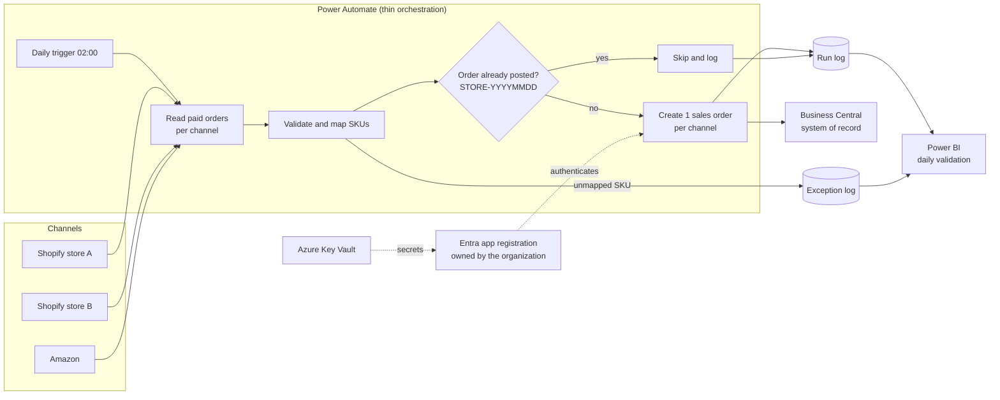

# Architecture: Daily B2C Order Batching into Business Central

This document describes the integration pattern shown in the [interactive demonstration](../demo/index.html).

## Problem

Commerce channels such as Shopify and Amazon generate many small B2C orders. Posting each one as its own ERP sales order creates noise in Business Central, and per-order flows built under personal accounts fail silently when that person leaves. Retried runs can also create duplicate orders.

## Solution

Once a day, a thin Power Automate flow reads the prior day's paid orders from each channel, validates them, sums lines by item, and posts **1 consolidated sales order per channel** to Business Central through its standard API. The flow runs under a service identity the organization owns, checks for a prior posting before writing, and logs every run for daily validation in Power BI.

## Design principles

| Principle | How it is applied |
|---|---|
| Logic lives in the system that owns the data | Pricing, tax, posting and inventory rules stay in Business Central and Shopify. The flow reads, sums and sends. |
| No database between enterprise systems | The flow calls the Shopify and Business Central APIs directly. Nothing is staged in an intermediate database. |
| Every run is rerunnable | The external document number `STORE-YYYYMMDD` is checked before writing, so a second run for the same day posts nothing. |
| Tied to no individual | Authentication uses a Microsoft Entra app registration owned by the organization, registered in Business Central with only the permissions it needs. Secrets live in Azure Key Vault. |
| Exceptions are surfaced, not lost | Lines with unmapped SKUs are held back and logged, so the order posts clean and the gap is visible the same morning. |
| Portable | 6 plain steps over standard APIs, so orchestration can move to another platform without rewriting business logic. |

## Components

| Component | Role |
|---|---|
| Shopify Admin API | Source of paid B2C orders per store |
| Power Automate (in a managed solution) | Scheduling, orchestration, logging; deployed through Development, Test and Production with source control |
| Microsoft Entra app registration | Service identity for Business Central API calls (client credentials) |
| Business Central API v2.0 (`salesOrders`) | System of record; receives 1 order per channel per day with its lines |
| Run log and exception log | Evidence for every run |
| Power BI | Daily check that source totals equal Business Central totals, with an exceptions list |

## Validation rule

For each channel and day: **Shopify total = Business Central order total + held exception amount.** Any difference raises a mismatch on the Power BI report.

See [flow-logic.md](flow-logic.md) for step-by-step logic and [../samples/bc-salesorder-payload.json](../samples/bc-salesorder-payload.json) for the request body.
